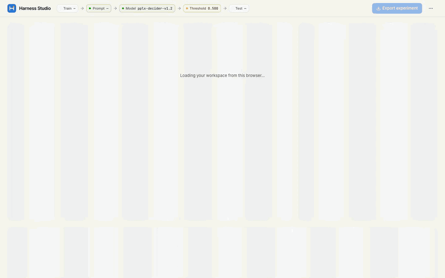

# Image Decisions Lab

Build, score and export image classification harnesses for decision models (OpenRouter's Decisions API).
A harness is a prompt (system text, a question, and ordered reference images) that a decision model answers
with class probabilities. Image Decisions Lab scores a harness on a training set, fits a threshold, and checks it on
a holdout test set, with every step hashed and exportable.



<sub>One-minute walkthrough of the core loop, recorded on the live app with real model calls ([MP4](docs/demo.mp4)): import a
dataset, score it, find the weak outputs, turn a miss into a reference example, tune the prompt, re-score, and see image
by image what the edit fixed and broke. Re-record with `scripts/record-demo.mjs` (instructions at the top of the file).</sub>

Everything runs in the browser: datasets, prompts, runs, cached answers and the API key live in IndexedDB and
local storage. Model calls go straight from the browser to `openrouter.ai`. There is no server code.

## Deploy

Point Vercel at this repository. `vercel.json` sets the framework, install and build commands; no environment
variables are needed (each user brings their own OpenRouter key).

```sh
npm install
npm run dev        # http://localhost:3000
npm run build      # what Vercel runs
```

## Workflow

1. **Datasets.** Upload a folder or zip in the Hugging Face ImageFolder layout (below). Each dataset gets a
   content hash over its images, labels and label schema; renaming never changes it. Download returns the same
   layout plus `dataset.json` with the hash and label counts.
2. **Prompt.** Write the system prompt, pick the label to classify, phrase the question and its criteria, and add
   reference images (positive/negative for yes/no labels, a class for class labels). Drag to reorder. The prompt
   hash covers everything sent to the model; the name is not part of it. The prompt menu duplicates, deletes
   (with confirmation), downloads and imports prompts.
3. **Settings.** Paste an OpenRouter key (checked against `/api/v1/key`, which shows the spending limit) and pick
   a decision model.
4. **Score the training set.** Accuracy, balanced accuracy, the score histogram, precision-recall curves and the
   confusion matrix. For yes/no labels (or one class versus the rest) the threshold is fitted to maximise balanced
   accuracy; drag it on the histogram to see every number and chart update. For the all-classes view the line is
   a review cutoff that flags low-confidence answers.
5. **Score the test set.** It always uses the training threshold, never its own.
6. **See what changed.** Next to the confusion matrix, each set lists the images that went from wrong to right
   (fixed) or right to wrong (broke) since the previous prompt version or model, with the change in balanced
   accuracy. Pick any earlier version to compare against, open an image, or show the group in the grid.
7. **Inspect.** Filter images by any label, predicted class, outcome (TP/FP/FN/TN or right/wrong), score range
   (drag across the histogram) or confusion-matrix cell; colour borders by label, prediction or outcome. Open an
   image for its probabilities, raw response, cost and cache key, and add hard training cases to the prompt as
   examples (test-set images are never offered). Image grids scroll inside their panel and page through large
   datasets (40, 80 or 160 per page).
8. **Class groups.** Merge or exclude classes to see whether a coarser label scores better. Scoring only:
   probabilities are summed per group, so no new calls are made.
9. **Export experiment.** One zip with the prompt (and exact request body), dataset manifests and hashes,
   per-image answers (JSONL and CSV), metrics, PR curves, confusion matrix, histogram, and the charts as SVG.

Answers are cached per (prompt hash, model, image hash), so re-scoring is free until something that changes the
request changes. After a prompt edit, the last results stay on screen marked as out of date.

The header shows the chain Train → Prompt → Model → Threshold → Test: green when results are current, amber when
something needs scoring, and each step flashes when its value changes. The ⋯ menu switches theme and reloads,
clears, or (with all local data) deletes the bundled demo.

Training and test sets must agree on the scored label (same key, type and classes); otherwise scoring is refused
and the mismatch is shown. Differences in other labels are shown as a warning.

## Dataset format

```
my-dataset/
  metadata.jsonl      {"file_name": "images/0001.jpg", "tube_count": "2", "has_open_tube": false}
  dataset.json        optional: {"name", "description", "schema": [{"key", "type", "classes", "description"}]}
  images/0001.jpg
```

JSON booleans (or true/false, yes/no, 0/1 in `metadata.csv`) make a yes/no label; strings make a class label.
`dataset.json` fixes the class order and declares classes a subset may not contain.

## Demo data

`public/demo` holds 27 training and 21 test photos of cluttered labware from
[LabWare_Items](https://huggingface.co/datasets/ABC-iRobotics/LabWare_Items) (ABC-iRobotics, MIT license).
Training frames come from 6 scenes and test frames from 4 other scenes. The one label, `fifty_ml_tubes`, is the
number of 50 ml conical tubes in view, hand-labelled per photo; frames where a tube is cut off or mostly hidden
were left out. Every 50 ml tube in this dataset is capped (the open-looking ones are self-standing tubes stood on
their caps), so there is no capped/uncapped label.

`seed.json` carries two versions of the prompt (v1: bare question; v2: tube anatomy plus three reference images)
and their cached answers from `perplexity/pplx-decider-v1.2` (the default model), so first-time visitors see results, and the run history
shows the improvement, without a key. To regenerate: `node scripts/build-demo-seed.mjs`, then with `npm run dev`
running, `OPENROUTER_API_KEY=… node scripts/capture-demo-runs.mjs` (scores the demo through the real UI; about a
cent). Bump `DEMO_VERSION` in `lib/demo.ts` so browsers holding an older demo swap it for the new one.

## Tests

```sh
npm test                                   # unit tests: metrics, threshold fitting, manifest parsing, hashing
npx playwright install chromium webkit
npm run e2e                                # end-to-end in Chromium and WebKit, against the dev server
OPENROUTER_API_KEY=… npm run e2e           # also runs the live scoring test
BASE_URL=http://localhost:3100 npm run e2e # against a running production build
```

## Metrics

- **Balanced accuracy**: mean per-class recall; for yes/no labels (sensitivity + specificity) / 2.
- **Threshold fit**: the cut on P(yes) (or P(class) one-vs-rest) with the highest balanced accuracy on the
  training set; ties go to the value closest to 0.5.
- **PR curves**: one per class, one-vs-rest on that class's probability, plus the micro-average; AP is the step
  sum of precision over recall increments.
